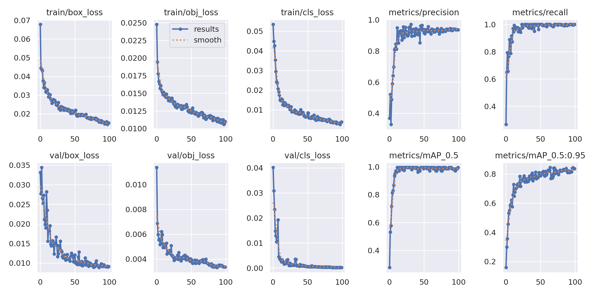
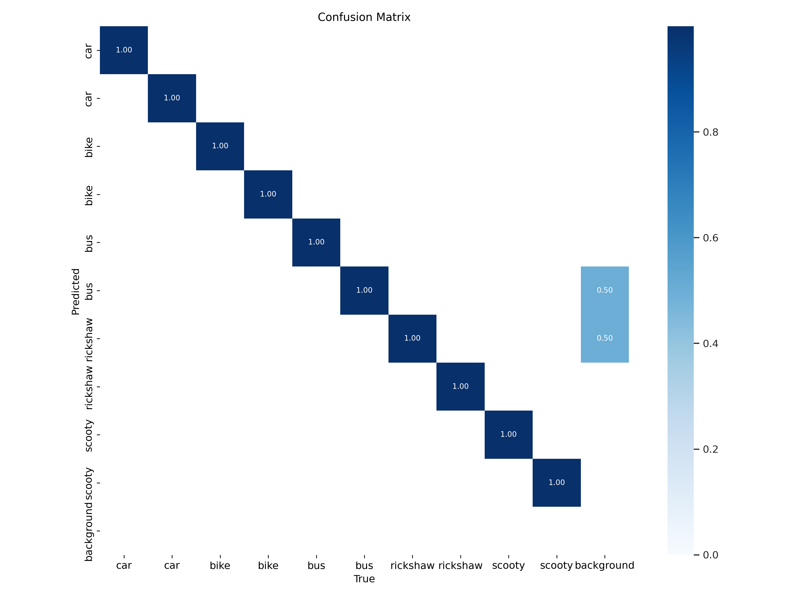
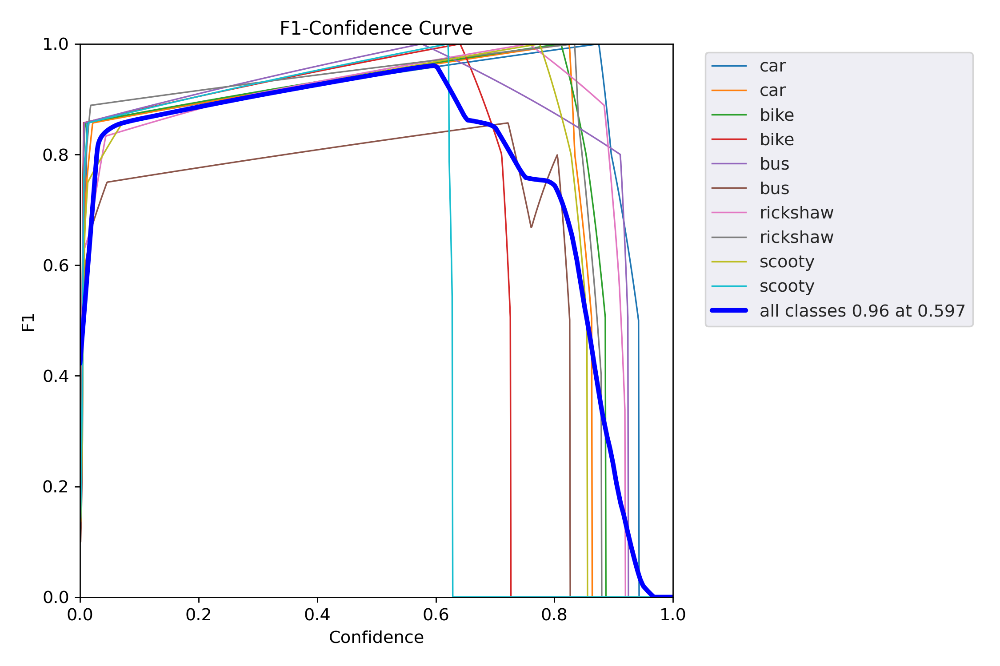
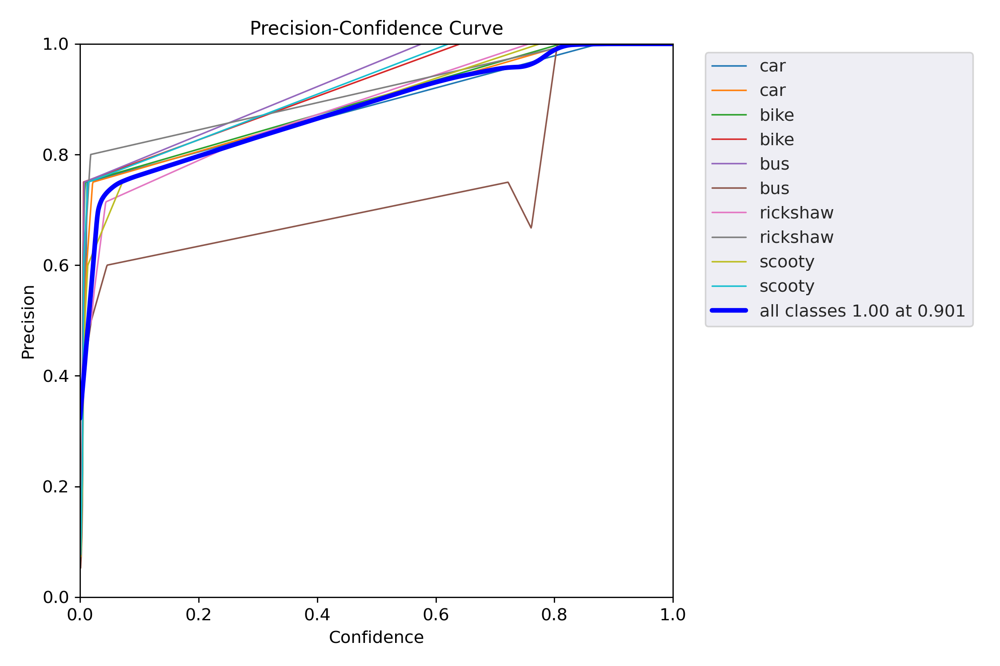
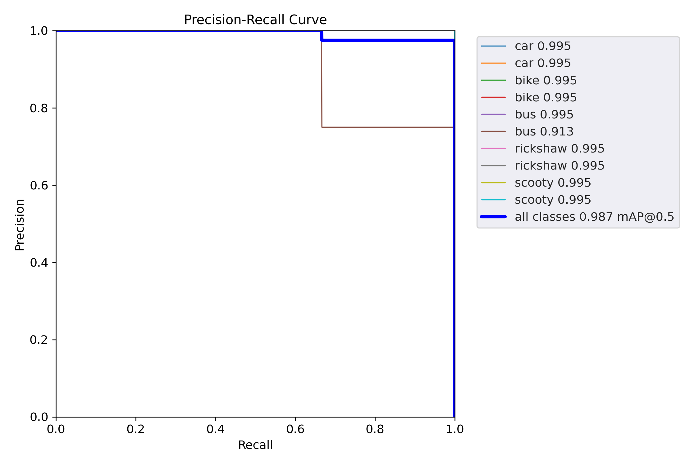
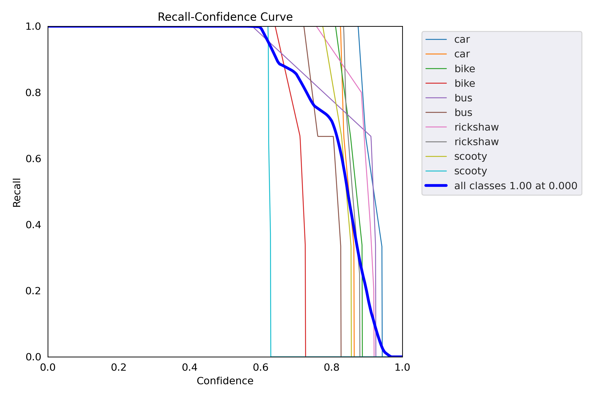

# Design and Development of Vehicle Recognition Using AIML

A Raspberry Pi–based vehicle recognition system that uses a custom-trained YOLOv5 model to detect vehicle categories, estimate the vehicle's dominant color, and display detection information on a 16×2 I2C LCD. The system is designed to start automatically on the Raspberry Pi and provide a compact embedded alternative to a full monitor-based setup.

## Project Overview

This project combines computer vision, deep learning, and embedded hardware to recognize vehicles from a live USB-camera feed.

**When a vehicle is detected**, the system displays its class, estimated color, and detection confidence on the LCD. **When no vehicle is detected in the current frame**, the display can show accumulated vehicle counts by category.

The detection program is configured to process approximately one frame per second to reduce the Raspberry Pi's computational load.

## Features

- Detects vehicle classes represented in the trained dataset, including cars, bikes, scooty, buses, and rickshaws.
- Estimates vehicle color from the detected region of interest.
- Displays vehicle type, color, and confidence on a 16×2 LCD using I2C.
- Maintains vehicle counts by category for display when no vehicle is currently detected.
- Uses a custom-trained YOLOv5 model.
- Supports automatic startup through a `yolo.service` systemd service.
- Uses affordable, compact Raspberry Pi hardware.

> **Note:** Detection quality depends on the training dataset, camera placement, lighting, occlusion, and the vehicle classes represented in the trained model.

## System Architecture

1. **Image capture:** A USB webcam captures the monitored area.
2. **Frame processing:** Python and OpenCV acquire frames from the camera.
3. **Vehicle detection:** The trained YOLOv5 model predicts vehicle classes and bounding boxes.
4. **Color estimation:** Image processing analyzes the detected vehicle region to estimate its dominant color.
5. **Output:** Vehicle class, estimated color, confidence, or accumulated counts are sent to the LCD over I2C.

## Hardware Requirements

| Component | Purpose |
|---|---|
| Raspberry Pi 4 Model B (4 GB RAM) | Runs the detection application |
| USB webcam | Captures live vehicle images |
| 16×2 LCD with I2C module | Displays detection results |
| microSD card | Stores Raspberry Pi OS, code, and model weights |
| USB-C power supply | Powers the Raspberry Pi |

### LCD I2C Connections

The project report specifies these Raspberry Pi connections:

| LCD I2C pin | Raspberry Pi connection |
|---|---|
| VCC | 5V (physical pin 2) |
| GND | Ground (physical pin 6) |
| SDA | GPIO2 / physical pin 3 |
| SCL | GPIO3 / physical pin 5 |

Check your particular LCD backpack and wiring before powering the circuit.

## Software and Technologies

- Raspberry Pi OS
- Python
- YOLOv5
- PyTorch
- OpenCV
- Miniforge/Conda for Python environment management
- I2C LCD library compatible with the LCD module
- `systemd` for automatic startup

## Repository Structure

The repository is intended to contain the project-specific code and trained model rather than a copy of the entire YOLOv5 source repository or the raw training dataset.

```text
my-yolov5-lcd-project/
├── assets/
│   ├── results.png
│   ├── confusion_matrix.png
│   ├── F1_curve.png
│   ├── P_curve.png
│   ├── PR_curve.png
│   └── R_curve.png
├── weights/
│   └── best.pt
├── pi_lcd_detect.py
├── requirements.txt
└── README.md
```

- `assets/results.png` — training metrics and loss curves, if included.
- `assets/confusion_matrix.png` — model validation confusion matrix, if included.
- `assets/F1_curve.png` — F1 score versus confidence threshold, if included.
- `assets/P_curve.png` — precision versus confidence threshold, if included.
- `assets/PR_curve.png` — precision–recall curve, if included.
- `assets/R_curve.png` — recall versus confidence threshold, if included.
- `weights/best.pt` — trained model weights.
- `pi_lcd_detect.py` — project-specific detection and LCD integration script.
- `requirements.txt` — Python dependencies used by the deployment environment.
- `.gitignore` — excludes local datasets, environments, caches, and other files that should not be committed.

The structure above is the intended layout. Adjust filenames and paths if your actual repository differs.

## Setup and Installation

These instructions outline the deployment process. Exact package versions, the LCD library, and the location of the YOLOv5 source code should match the working Raspberry Pi installation.

### 1. Prepare the Raspberry Pi

1. Install Raspberry Pi OS on the microSD card.
2. Boot the Raspberry Pi and connect it to a network if required.
3. Connect the USB camera.
4. Connect the 16×2 LCD's I2C module using the wiring table above.
5. Enable I2C using the Raspberry Pi configuration tools, then reboot if prompted.

### 2. Create a Python environment

If you use Miniforge/Conda, create and activate an environment with a Python version compatible with the project's PyTorch, YOLOv5, and LCD dependencies.

```bash
conda create -n vehicle-detection python=3.10
conda activate vehicle-detection
```

The Python version shown is an example; use the version that works with your tested Raspberry Pi OS and dependency combination.

### 3. Clone YOLOv5 and install dependencies

First, clone the official YOLOv5 repository and enter its directory:

```bash
git clone https://github.com/ultralytics/yolov5.git
cd yolov5
```

Next, copy the project-specific files from this project into the cloned `yolov5` folder. Add `pi_lcd_detect.py` and the trained `weights/best.pt` file, and replace or update any files only where this project requires it. Keep the original YOLOv5 files that the detection script depends on; do not delete the repository's model code.

Then install YOLOv5's dependencies from inside the cloned repository:

```bash
pip install -r requirements.txt
```

If this project has additional packages not listed in YOLOv5's `requirements.txt`, install those too. If you maintain a separate project `requirements.txt`, review it and install any missing dependencies. Use a YOLOv5 version compatible with the trained `best.pt` weights and the Raspberry Pi's Python/PyTorch setup.

### 4. Add the trained model

Place the trained weights at:

```text
weights/best.pt
```

Make sure the path in `pi_lcd_detect.py` matches this location. If the script expects a different path or a `best.pt` file beside the YOLOv5 source, update the path accordingly.

### 5. Connect and test the camera and LCD

Before configuring automatic startup, run the detection script manually from the environment and directory expected by the code. Confirm that:

- The camera opens successfully.
- The model loads without errors.
- Vehicle labels and confidence values are produced.
- The LCD displays the detection details.
- The count display behaves as expected when no vehicle is detected.

The exact command depends on how `pi_lcd_detect.py` loads YOLOv5. For example, if it is configured to run directly from the project root:

```bash
python pi_lcd_detect.py
```

Use the actual command and working directory required by your script.

## Automatic Startup on Boot

The project uses a `systemd` service named `yolo.service` to launch the detection program when the Raspberry Pi starts.

A service configuration must use the correct absolute paths for:
- The Python interpreter in the project environment.
- The detection script.
- The working directory containing the YOLOv5 code and model files.
- Any required environment variables or device permissions.

After configuring the service, enable it and check its status:

```bash
sudo systemctl daemon-reload
sudo systemctl enable yolo.service
sudo systemctl start yolo.service
sudo systemctl status yolo.service
```

To inspect service logs when troubleshooting:

```bash
journalctl -u yolo.service -e
```

These commands assume that you have created and installed a valid `yolo.service` file. A working service file is environment-specific, so use the one tested with your actual project paths.

## Model Evaluation

The project report records the following overall validation results for **29 images and 33 instances**:

| Metric | Reported result |
|---|---:|
| Precision | 0.922 |
| Recall | 1.000 |
| mAP@0.5 | 0.987 |
| mAP@0.5:0.95 | 0.847 |

Precision measures the proportion of detections that are correct. Recall measures the proportion of ground-truth objects detected. mAP@0.5 evaluates detection performance at an IoU threshold of 0.50, while mAP@0.5:0.95 averages performance across IoU thresholds from 0.50 to 0.95.

These are the values reported for the project's validation set; they should not be interpreted as a guarantee of identical performance in every real-world environment.

### Results Visualizations

If included in the repository, the following images can be displayed here:

**Training results**



**Validation confusion matrix**



**F1 curve**



**Precision (P) curve**



**Precision–recall (PR) curve**



**Recall (R) curve**



## Project Team

- Patil Anushka Abhijit Aarti -[@anubytepatil-alt](https://github.com/anubytepatil-alt)
- Patil Mitali Sanjay Manisha  -[@mitalipatil2605-beep](https://github.com/mitalipatil2605-beep)
- Bhoir Viraj Ravindra Savita - [@VirajBhoir2512](https://github.com/VirajBhoir2512)
- Mhaske Sahil Sanjay Suhasini - [@mhaskesahil](https://github.com/student-sahi)

